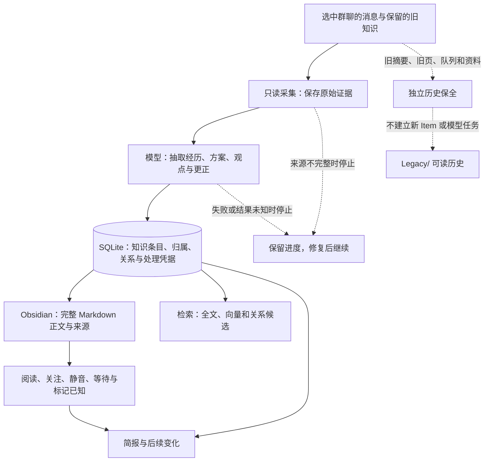

# WGO 语义整理：实现走读

从这里顺着读就够了。完整大图和源码表收在文末，日常阅读不需要另外打开 viewer、
拖动画布或记住节点编号。本文描述候选源码；一台机器是否完成迁移和激活，要另看
该次运行的验收结果。

## 一条消息最后变成什么



**正文是你真正要读的成果。** 同一件事可以跨天、跨群补充和更正，WGO 将证据接到
持续更新的 Item 上。成员归属来自该条消息已有的身份与名字；转述、本人经历和
被谈论的人保持区分。内容适合比较时用小表格，适合步骤时用列表，原话用带归属的
引用；不要求每页套同一个模板。实现入口是
[`SemanticEngine`](../../core/semantic/engine.py) 与
[`BodyPlanWriter`](../../core/semantic/projections.py)。

**旧知识与原始消息走不同的 lane。** 新 plan 的 `source-first-v1` 只让 selected
WeChat raw snapshots 进入 capture/extraction/resolution。旧 topic/event 摘要、原页、
Review Queue、selection 和 resource envelope 作为 immutable history passes 保全，
在 `Legacy/History/<manifest_id>/` 与 `Legacy/Index.md` 中可读；它们不产生新 Item，
也不满足 semantic processing。只有没有 policy 字段的旧 plan 才走原来的
`legacy-semantic-v1` import compatibility path。

**`View` 是主题目录页。** 比如一个 Item 同时与「申请材料」和「签证」有关，两处
目录都可以链接到它的正文或具体段落。正文仍只有一个维护位置。View 在 Obsidian 的
`WGO/视图/` 下，不需要独立应用、网站或操作入口；实现是
[`ProjectionPublisher.publish_view`](../../core/semantic/projections.py)。

**向量帮助找回材料。** Embedding 把检索文本转成向量，index 保存可重建的检索数据；
两者可分别选本地或 Cloudflare。模型与 canonical store 负责知识内容和合并决定。
所选网络 provider 会接收对应文本；具体边界见 [provider contract](../semantic-providers.md)。

## 全量洗笔记与以后更新

首次重建先冻结范围、停止精确的受管理 app 并备份，再完整观察来源、逐 pass 保全旧历史、
处理原始聊天、生成正文和索引。第二次独立来源观察和 conservation 校验通过后，才切换
active generation、恢复 app，并验证真实增量接续。抓到原始消息只是中间步骤；
模型任务、正文生成和激活各有自己的完成证据。

激活后，同一个 engine 继续处理新消息。`captured` 表示原始资料已保存，`applied`
表示整批已完成语义处理；模型失败可以让前者领先后者，不能把失败算成“已经洗好”。
故障恢复沿原 run 继续，操作步骤见 [重建 runbook](../semantic-rebuild.md)。

阅读操作见 [Obsidian 使用说明](../semantic-workflow.md)。下面保留完整技术图，供追踪
具体 owner、失败边和源码；它与上面的阅读路线描述同一套实现。

<details>
<summary>展开完整技术 Mermaid、状态归属与源码表</summary>

完整可编辑源：[semantic-implementation.zh-CN.mmd](semantic-implementation.zh-CN.mmd)。
便携导出：[完整 SVG](../assets/architecture/semantic-implementation.zh-CN.svg)。
功能图见 [semantic-functional.zh-CN.excalidraw](semantic-functional.zh-CN.excalidraw)，
模块与权威图见 [semantic-core.zh-CN.excalidraw](semantic-core.zh-CN.excalidraw)。

## 范围与事实边界

- 图与本文描述当前 checkout 的 **candidate 源码**。源码存在一条能力路线，不等于
  安装、激活、真实来源读取、账户额度使用、真实重建或本机验收已经发生。
- `relocate` 是仓库内的**候选源能力**（`(cand)`），以实际源码为证。
- 图中不出现具体部署的私有路径、账户、群标识或 consumer 品牌。
- 图表达实现契约与失败去向；它不替代
  [semantic-store-contract.md](../semantic-store-contract.md)、
  [semantic-engine.md](../semantic-engine.md)、
  [semantic-providers.md](../semantic-providers.md)、
  [semantic-reading.md](../semantic-reading.md)、
  [semantic-legacy.md](../semantic-legacy.md)、
  [monitor-state-v3.md](../monitor-state-v3.md)、
  [semantic-rebuild.md](../semantic-rebuild.md) 的机器契约。

## 怎么读图

1. **region（子图）** 对应真实的 ownership 边界（进程、SQLite owner、provider
   adapter、operator CLI）。跨 region 的边就是跨所有权调用或载荷传递。
2. **前缀标记**（文本标记，不依赖颜色）：
   - `(C)` canonical 权威，或 durable canonical 状态（含 reader ledger 与已接受
     page/model artifact）。
   - `(D)` derived 可重建输出（Markdown 页、index、缓存）。
   - `(O)` optional / network / inert；`(X)` repo 外 adapter；`(cand)` 候选分支。
   - `(inv)` 失败关闭不变式或失败状态。
3. **线型**：实线 = 成功路径（带动词/载荷）；虚线 = 门 / 失败 / 恢复 / 不变式。
4. **典型 lane 走向**：entry → transformation → canonical state → derived side
   effect → reader/operator 可观察结果。并非所有 lane 都是直链：跨 plane 的关系
   保留为显式边，失败与恢复边给出明确去向（见「走读」）。以合流/分叉表达真实
   调用，而不是把所有写操作糊到同一条边上。

## 图例

| 标记 | 含义 | 典型节点 |
| --- | --- | --- |
| `(C)` | canonical 权威 / durable canonical 状态 | `STORE`、`MS`、`SRC_INV`、`CONFIG`、`JOBS`、`WATCH`、`PIN`、`LEDGER`、`RES_DB` |
| `(D)` | derived 可重建输出 | `OUTBOX`、`RETRIEVAL`、`LOCAL_IDX`、`WGO`、`BODY_PAGE`、`PUB`、`LEG_NAV` |
| `(O)` | optional / network / inert | `MCP`、`LOCAL_EMB`、`CF_EMB`、`CF_VEC`、`CF_DEC`、`USAGE`、`INBOX`、`LINKS`、`DRIVE` |
| `(X)` | repo 外 adapter | `EXT` |
| `(cand)` | 候选恢复分支 | `RELOC` |
| `(inv)` | 失败关闭不变式 / 失败状态 | `INV_NOWRITE`、`INV_INDEX`、`INV_ATTR`、`ROOT_ERR` 等 |

## 区域与状态归属

| Region | 拥有者 / 入口 | 关键节点 | 拥有的状态与写入权 |
| --- | --- | --- | --- |
| `ENTRY` | `app.py`、`mcp_server.py`、`scripts/*` | `APP` `QMAIN` `COALESCE` `T_*` `MCP` `CLI_*` `WECHAT_APP` | 进程生命周期 timer、daemon worker、主线程 UI 队列；MCP 只读兼容 |
| `SOURCE` | `WeChatDB` / `SourceInventoryStore` / 进程内 gate | `WECHATDB` `SRC_INV` `ADAPTER` `GATE` `CAPLOCK` `DECRYPT` `GUARD` | 只读来源；期望分片集合；generation/key/decrypt/snapshot/page 边界 |
| `CAPTURE` | `core/semantic/source.py`、`MonitorStateStore` | `RUNTIME_ACTIVE` `SEM_CAP` `BRIDGE` `MS` `MS_CAP` `MS_APP` | monitor 检查点 v3：captured 与 applied 两条向量（唯一写入者 `MS`） |
| `WORK` | `JobStore` / `ProviderScheduler` | `JOBS` `SCHED` `ROLES` `TEXT_PROV` `DEC_SEL` `CF_DEC` | 已验证 artifact 先落盘；进程内 admission；不持有 DB 事务/provider |
| `ENGINE` | `SemanticEngine` / `WatchService` / `attribution` | `ATTR` `EXTRACT` `RESOLVE` `CONSOL` `VIEWS` `WATCH` | 抽取/解析/合并/watch 计算；canonical 写入仍走 `STORE` |
| `CANON` | `SemanticStore`（generation SQLite） | `STORE` `TABLES` `PROOF` | canonical 事务、revision CAS、不可变对象、独立 processing 证明 |
| `DERIVED` | `HybridRetriever` / `ai.*` adapter | `RETRIEVAL` `EMB_SEL` `IDX_SEL` `LOCAL_IDX` `LOCAL_EMB` `CF_EMB` `CF_VEC` `USAGE` `HTTP` | 可重建索引与向量；不决定 merge |
| `READING` | `projections/controls/briefing/delivery/reader_runtime` | `LEDGER` `BODY_PLAN` `BODY_PAGE` `PUB` `CONTROLS` `BRIEF_ACCEPT` `BRIEF_FILE` `DELIV` `READER_RT` `INBOX` `WGO` | `reader_*` durable 消费状态；Markdown 投影；交付 receipt |
| `RES` | `resource_capture` / `resource_backup` / Drive | `RES_CAP` `RES_DB` `RES_BACK` `CAS` `MOUNTED` `OBSIDX` `DRIVE` `DRIVE_DB` `REMOTE` `EXT` `LINKS` | occurrence 身份、CAS v3 snapshot、独立投影状态、link 惰性面 |
| `REBUILD` | `RebuildCoordinator` / `GenerationRegistry` | `COORD` `MANAGED` `JOURNAL` `PIN` `CUT` `VERIF` `COORD_V3`…`COORD_LIVE` `COORD_ROLLBACK` `RELOC` | 冻结计划、切换 journal、active pin、独立 verifier、分步切换/回滚 |
| `LEGACY` | legacy topic/event、`semantic/legacy.py` | `LEG_PATH` `LEG_INVENTORY` `HISTORY_STORE` `HISTORY_PUB` `LEG_NAV` `LEG_BLOCK` `LEG_DB` | 未 pin 前的真实兼容路径；source-first 旧历史只读保全；旧 DB 不改写 |
| `PLATFORM` | `core/platform`、`ConfigStore` | `CONFIG` `PLAT` `WIN` `ROOT_ERR` | 主配置唯一写入者；lock/path/private storage/secrets；runtime root 失败关闭 |
| `INVAR` | 跨 region 约束 | `INV_*` | 只读来源、index 不决定 merge、身份不可推断、字节同意、不 ACK 等 |

## 走读：实际链条（entry → 载荷 → canonical → 派生 → 可观察结果 + 失败去向）

1. **长寿命进程与入口**：`APP` 拥有 `T_*` timer 与 daemon worker；只有 prepared UI
   data 经 `QMAIN` 回主线程；重复的 chat-menu 刷新经 `COALESCE` 收敛为一个 pending
   source worker。`MCP`（`(O)`）只读兼容，`MCP_SEND` 是 `mcp_send_retired` 惰性
   stub；MCP 需要独立 SDK，不是普通安装依赖。
2. **只读来源边界**：`RUNTIME_CHECK` 要求 `SRC_INV` complete inventory，再经
   `SEM_CAP` → `WECHATDB`（`for_runtime`）有界读；`GATE`/`CAPLOCK` 是门与锁，
   `DECRYPT` 产出不可变已发布 payload；短命 source CLI 需显式 grant。
   `GUARD` 检查来源 metadata freshness，并可能在后台拉起 WeChat 客户端
   （`WECHAT_APP`），但绝不 content read / 开 UI / 刷新 key / 终止进程。
3. **采集与检查点 v3**：`SEM_CAP` 先 `capture_batch`（原始 bytes 落 `STORE`），
   再由 `BRIDGE` 解析 durable DB 证据产出 CAS 绑定；`MS_CAP`（captured）随 raw
   落盘前进，`MS_APP`（applied）必须等完整 processing receipt。provider 失败时
   `SCHED -.-> MS_CAP`：captured 可领先 applied，但不 ACK。
4. **作业与 provider 准入**：`EXTRACT` → `JOBS`（已验证 artifact 先落盘）→
   `SCHED`（进程内 admission）→ `ROLES`。`ROLES` 给出三个**独立**角色：`text` →
   `TEXT_PROV`；`decision role` → `DEC_SEL`（text 路由复用 `TEXT_PROV`，或 `CF_DEC`
   走网络与 Workers AI 预算）；`embedding role` → `EMB_SEL`。`SCHED -.->`
   `INV_NOLOCK`：等 provider 不持有 DB 事务/projection lock；`JOBS -.->`
   `INV_PROPOSAL` 区分 accepted proposal 与 canonical commit。
5. **引擎**：`EXTRACT` 产出 0..N Observations（连续 2000 字符 span）；`ATTR`
   区分 speaker / quoted author / subject（`INV_ATTR`）；`RESOLVE` 用候选 + typed
   decision 提交 canonical `STORE`；`CONSOL` 做 merge/split/relation，`VIEWS` 做
   view 定义与 membership，二者由 `COORD` 的阶段入口调用；`WATCH` 维护精确
   temporal witness/Episode，并从 `STORE` 读 canonical claims/relations。
6. **canonical 权威**：`STORE` 在 `BEGIN IMMEDIATE` 事务内做 revision CAS，写
   `TABLES`（不可变 source versions/Observations/Items/claims/relations/Views/
   change events），并派生 `OUTBOX`。`PROOF`（`verify_processing_receipt`/
   `complete_batch`）独立重建处理证明，回填 `BRIDGE` → `MS_APP`。派生输入也从
   这里分发：`STORE → BODY_PLAN`（canonical Item 与证据快照）、
   `STORE → BRIEF_ACCEPT`（canonical change events）、`STORE → WATCH`（claims）。
7. **可重建检索**：`RETRIEVAL`（lexical+dense+structural+unindexed tail）先经
   `EMB_SEL` 选择 embedding，再由 `IDX_SEL` **独立**选择 index；四种 cross 组合
   都合法，`INV_EMB_ID` 要求各自的 profile/dim/generation 身份不可混用。
   Cloudflare 路径走 `USAGE` reservation，未确认 mutation 保持 pending；
   `RETRIEVAL -.-> INV_INDEX`。search 结果进 `CONTROLS`。
8. **阅读投影**：`BODY_PLAN` 是 durable accepted artifact（存于 reader ledger）；
   `BODY_PAGE`（`(D)`）是它渲染出的 Markdown（表格/列表/带归属引用，单一 detail
   home），经 `PUB` 写入 `WGO/`。冲突留 exact bytes + draft + status 走
   `CONTROLS`。`LEDGER` 是 durable canonical 消费状态（偏好/known/open/delivery
   receipt/已接受 text artifact），不是可丢弃派生。`BRIEF_ACCEPT`（`(C)`）冻结
   edition 文本到 `BRIEF_FILE`（`(D)`），并按 change floor 选候选。`DELIV`（`(C)`）
   经 `NOTIF` 投递，unknown 需 reconcile。`INBOX`（`(O)`）是 visible-open 桥，
   无插件时手动 known；`INV_SEP` 保证 edition/read/known/notification acceptance
   各自独立；history rebuild 不补发通知。
9. **资源与附件**：`RES_CAP`（contexts 默认 off）只读 occurrence 并绑定 `RES_DB`
   （capture/selection 权威），再进入 `RES_BACK` → `CAS`；`RES_BACK` 先封 v3
   machine snapshot `COMPLETE`，再独立尝试 `MOUNTED`/`OBSIDX`。Direct Drive 自持
   来源读取与 `DRIVE_DB`（`drive_scan_shards` 队列 + opaque cursor token）及 remote
   upload；`REMOTE` 未知不升级为 verified。`EXT`（`(X)`）在 repo 外复用 transport；
   `LINKS`（`(O)`）已惰性化；`INV_BYTES` 保证 source-readable 不等于附件字节同意。
10. **迁移与切换**：`COORD` 冻结计划、经 `MANAGED` 停精确 app + `AppInstanceLock`，
    做 Online Backup 与 C0/C1 完整来源观测、固定投影发布与 `verify`。新 plan 的
    `HISTORY_PASS` 对每个 retained freeze 走 `LEG_INVENTORY`，写
    `HISTORY_STORE` 的 immutable pass/file/backup receipts，再由 `HISTORY_PUB`
    发布 `LEG_NAV`；旧历史不进入 semantic `STORE`、Item 或 job。无 policy 的旧
    plan 才经 `LEGACY_SEM_IMPORT` 使用原 `capture_batch` compatibility path。
    `VERIF` 按 pass 读取 history payload 和实际导航/备份，同时独立检查原始
    source conservation。切换顺序拆成显式小节点：`COORD_V3`（install_v3 CAS）→
    `COORD_PIN`（active manifest）→ `COORD_PROV`（durable provisional receipt）→
    `COORD_RELEASE`（释放锁）→ `COORD_RESTORE_APP`（exact restore，最新
    `restore_attempts` 决定观察结果）→ `COORD_LIVE`
    （真实 applied/processing receipt 的 live 验收）。`COORD_ROLLBACK` 经
    `restore_checkpoint` revision CAS，保留新 captures/reading/delivery 证据；
    `CUT` 半切换启动 fail closed；`VERIF` 独立 conservation；`RELOC`（`(cand)`）
    是 relocation 候选分支（同 run/gen）。
11. **generation pin 切换**：`RUNTIME_ACTIVE` 在 `pin=None` 时走 `LEG_PATH`
    （真实兼容路径），pin 存在时 semantic 唯一 owner；`LEG_BLOCK` 在 pin 后让旧
    writer fail closed；`CUT`/`PIN` 对 in-progress cutover fail closed。
    当显式配置的 runtime root 不可用时，`PIN`/`RUNTIME_ACTIVE`/`APP`/`CLI_HEALTH`/
    `LEG_PATH` 都经 `ROOT_ERR` fail closed 为 `semantic_runtime_root_unavailable`，
    **不**回落 legacy。`WIN`（`(O)`）说明 Windows 共享基础不等于 Windows
    source/runtime 支持。

## 证据表（repo-relative anchors）

> 锚点为类名/函数名，行号可变；未在源码中出现的项明确标注。

| 图中节点/边 | 类型 | 源码 anchor |
| --- | --- | --- |
| `APP` / UI 队列 / 合并刷新 | node | `app.py :: WeGroupchatObsidianApp.__init__`、`_process_main_queue`、`_chat_menu_source_pending` |
| `T_*` timer | node | `app.py :: _configure_monitor_timer`、`_configure_semantic_reader_timer`、`_configure_source_guard_timer`、`_configure_resource_backup_timer`、`_configure_drive_sync_timer`、`_configure_daily_digest_timer` |
| `MCP` / `MCP_SEND` | node | `mcp_server.py :: get_status`、`summarize_chat`、`_MCP_SEND_RETIRED_RESPONSE` |
| `CLI_REBUILD` / `CLI_HEALTH` / `CLI_SOURCE` | node | `scripts/rebuild_knowledge.py :: main/status/restore-runtime`；`scripts/health_check.py :: main`（`--semantic-json`）；`--allow-transient-wechat-source-read` |
| `WECHATDB` | node | `core/wechat_db.py :: WeChatDB.for_runtime` |
| `SRC_INV` | node | `core/source_inventory.py :: SourceInventoryStore.inspect`、`reconcile` |
| `ADAPTER` | node | `core/source_adapter.py :: read_source_page`、`decode_cursor_token`、`bind_source_inventory` |
| `CAPLOCK` | node | `core/resource_capture.py :: resource_capture_operation_lock` |
| `GUARD` / `WECHAT_APP` | node | `core/wechat_source_guard.py :: WeChatSourceGuard.check`、`default_process_probe`、`launch_wechat` |
| `RUNTIME_ACTIVE` / `RUNTIME_CHECK` | node | `core/semantic/runtime.py :: SemanticRuntime.active`、`check_monitor`、`legacy_command_blocked`、`validate_profile` |
| `SEM_CAP` / `BRIDGE` | node | `core/semantic/source.py :: SemanticCapture.page/snapshot`、`MonitorReceiptBridge.capture/processing/migration` |
| `MS` / `MS_CAP` / `MS_APP` | node | `core/monitor_state.py :: MonitorStateStore.install_v3/commit_capture/commit_applied/restore_checkpoint/inspect` |
| `JOBS` | node | `core/semantic/jobs.py :: JobStore.ensure/claim/accept/fail/renew/defer/finish/reconcile_unknown` |
| `SCHED` / `ROLES` | node | `core/semantic/scheduling.py :: ProviderScheduler.call/map`、`scheduled_providers`；`core/semantic/runtime.py :: ProviderRoles.from_profile/preflight` |
| `TEXT_PROV` / `DEC_SEL` / `CF_DEC` | node | `ai/semantic_provider.py :: LegacyTextProvider`、`TextDecisionProvider`；`ai/cloudflare_provider.py :: CloudflareDecisionProvider`；`ai/factory.py :: create_provider` |
| `ATTR` | node | `core/semantic/attribution.py :: source_attribution`、`captured_source_metadata` |
| `EXTRACT` / `RESOLVE` / `CONSOL` / `VIEWS` | node | `core/semantic/engine.py :: SemanticEngine.extract_batch/resolve_batch/consolidate/reconcile_views` |
| `WATCH` | node | `core/semantic/watches.py :: WatchService.create_watch/evaluate/sync_reader_watch/open_episode/sync_episodes` |
| `STORE` / `TABLES` | node | `core/semantic/store.py :: SemanticStore.capture_batch/commit_extraction/apply_proposal/create_view/update_view/record_claim_relation/restore_identity_operation` |
| `PROOF` | node | `core/semantic/store.py :: verify_processing_receipt`、`complete_batch`、`record_migration_receipt` |
| `OUTBOX` | node | `core/semantic/store.py :: pending_outbox/ack_outbox/supersede_projection_outbox` |
| `RETRIEVAL` / `LOCAL_IDX` | node | `core/semantic/retrieval.py :: HybridRetriever.prepare_index/index_pending/confirm_pending/search/relation_candidates`；`ai/vector_index.py :: LocalCosineIndex` |
| `EMB_SEL` / `IDX_SEL` | node | `core/semantic/runtime.py :: validate_profile`（`embedding` 与 `vector_index` 各自 `local`/`cloudflare`）；`ai/semantic_provider.py :: EmbeddingProfile.profile_id` |
| `LOCAL_EMB` / `HTTP` | node | `ai/local_embedding_provider.py :: LocalEmbeddingProvider`、`LoopbackTransport`、`LocalEmbeddingProfile` |
| `CF_EMB` / `CF_VEC` / `USAGE` | node | `ai/cloudflare_provider.py :: CloudflareEmbeddingProvider`；`ai/vector_index.py :: CloudflareVectorizeIndex`；`core/provider_usage.py :: ProviderUsageStore.confirm_budget/reserve/mark_sent/settle/mark_unknown/cancel` |
| `LEDGER` | node | `core/semantic/projections.py :: ReadingLedger`（reader_* 表：偏好/known/open/delivery receipt/已接受 text artifact） |
| `BODY_PLAN` / `BODY_PAGE` / `PUB` | node | `core/semantic/projections.py :: BodyPlanWriter`、`ProjectionPublisher.publish_item/publish_view/publish_canonical_item/prepare_canonical_item/publish_prepared_item/publish_document/resolve_proposal`、`validate_body_plan` |
| `CONTROLS` | node | `core/semantic/controls.py :: ReaderControls.property_mapping/sync_properties/register_item_actions/process_management/observe_open/mark_known/run_query`、`CoreSearchAdapter` |
| `BRIEF_ACCEPT` / `BRIEF_FILE` | node | `core/semantic/briefing.py :: BriefingService.build/edition/history/rebuild` |
| `DELIV` / `NOTIF` | node | `core/semantic/delivery.py :: DeliveryService.register/deliver/reconcile/resolve_click`；`app.py :: _SemanticNotifier` |
| `READER_RT` / `INBOX` | node | `core/semantic/reader_runtime.py :: ReaderRuntime.poll/deliver_changes/deliver_brief`；`integrations/obsidian/` |
| `WGO` | node | `core/semantic/projections.py :: ProjectionPublisher`（managed root） |
| `RES_CAP` / `RES_DB` | node | `core/resource_capture.py :: SelectedResourceCapture`、`resource_capture_operation_lock`、`_captures_contexts` |
| `RES_BACK` / `CAS` / `MOUNTED` / `OBSIDX` | node | `core/resource_backup.py :: MountedResourceBackup.run/_run_owned/_run_locked/status` |
| `DRIVE` / `DRIVE_DB` / `REMOTE` | node | `core/google_drive_file_sync.py :: GoogleDriveFileSync.scan/run/status`；`core/google_drive_auth.py :: GoogleDriveOAuth`、`ProtectedRefreshTokenStore`；`drive_scan_shards` 队列与 cursor token 见 `docs/WINDOWS-PORT-MAP.md` |
| `LINKS` / `DISABLED_LINK_PREVIEW` | node | `core/link_preview.py :: fetch_link_preview`、`LINK_PREVIEW_STATE` |
| `COORD` / `MANAGED` / `JOURNAL` | node | `core/semantic/rebuild.py :: RebuildCoordinator.plan/execute/resume/status/restore_runtime/verify/rollback`、`_preserve_history`、`_job_state_summary`、`_restore_runtime`、`ManagedRuntime.stop_and_lock/restore`、`RebuildJournal`、`core/semantic/rebuild_payloads.py` |
| `PIN` / `CUT` | node | `core/semantic/rebuild.py :: GenerationRegistry.pin`、`GenerationPin`、`RebuildJournal.begin_cutover/activate_pointer/finalize` |
| `VERIF` | node | `core/semantic/verification.py :: RebuildVerifier.verify` |
| `COORD_V3`…`COORD_LIVE` / `COORD_ROLLBACK` | node | `core/semantic/rebuild.py :: RebuildCoordinator._finish_cutover/_live_check/_finish_rollback_restore/_rollback_checkpoints`；`core/monitor_state.py :: install_v3/restore_checkpoint` |
| `RELOC` | node | `core/semantic/rebuild.py :: RebuildCoordinator.relocate/_relocation_*` |
| `HISTORY_PASS` / `LEG_INVENTORY` / `HISTORY_STORE` / `HISTORY_PUB` / `LEG_NAV` | node | `core/semantic/rebuild.py :: _preserve_history`；`core/semantic/legacy.py :: plan_legacy/preserve_legacy_history/record_legacy_backups/build_history_publication_plan/publish_legacy_navigation`；`core/semantic/verification.py :: _verify_history` |
| `LEGACY_SEM_IMPORT` / `LEG_BLOCK` | node | `core/semantic/legacy.py :: import_legacy/derive_topic_item_map/record_legacy_resolution/build_publication_plan`（仅 `legacy-semantic-v1`）；`core/semantic/runtime.py :: legacy_command_blocked` |
| `CONFIG` / `PLAT` / `WIN` | node | `core/config.py :: ConfigStore.update/inspect`；`core/platform/*`；`docs/WINDOWS-PORT-MAP.md` |
| `ROOT_ERR` | node | `core/semantic/rebuild.py :: GenerationRegistry.pin`（`semantic_runtime_root_unavailable`）；`core/semantic/runtime.py :: SemanticRuntime.active`、`legacy_command_blocked`；`core/semantic/health.py :: semantic_health` |
| 边 `SEM_CAP --> STORE` | edge | `core/semantic/store.py :: capture_batch` |
| 边 `PROOF --> BRIDGE --> MS_APP` | edge | `core/semantic/store.py :: complete_batch` + `core/semantic/source.py :: MonitorReceiptBridge.processing` + `core/monitor_state.py :: commit_applied` |
| 边 `SCHED -.-> MS_CAP` | edge | `core/semantic/runtime.py :: check_monitor`（captured 先行） |
| 边 `STORE --> BODY_PLAN/BRIEF_ACCEPT/WATCH` | edge | `core/semantic/projections.py :: CanonicalReadingAdapter.snapshot`；`core/semantic/briefing.py :: BriefingService.build`；`core/semantic/watches.py :: WatchService.evaluate` |
| 边 `RES_DB --> RES_BACK --> CAS` | edge | `core/resource_backup.py :: MountedResourceBackup._run_owned/_run_locked` |
| 边 `HISTORY_PASS --> HISTORY_PUB --> LEG_NAV` | edge | `core/semantic/rebuild.py :: _preserve_history`；`core/semantic/legacy.py :: build_history_publication_plan`、`publish_legacy_navigation` |
| 边 `PUB --> CONTROLS`（冲突） | edge | `core/semantic/projections.py :: publish_document`、`resolve_proposal` |
| 不变式 `INV_*` | inv | `core/semantic/runtime.py`、`core/semantic/store.py`、`core/source_inventory.py`、`core/url_safety.py :: redact_urls_in_text/redact_urls_with_offsets/sensitive_url_key` |

## 源码与 activation 边界

- 图是**能力路线**：`SemanticStore`、`MonitorStateStore` v3、`RebuildCoordinator`
  等都在源码中存在；是否已安装配置、已激活某 generation、已读取真实来源或已使用
  账户额度，图上不作断言。
- `GenerationRegistry.pin()` 返回 `None` 时，legacy topic/event 路径是真实运行
  路径；只有 active manifest 存在时 semantic runtime 才是唯一 owner。
- 显式 runtime root 不可用时 fail closed 为 `semantic_runtime_root_unavailable`，
  不回落到空 root 或 legacy。
- `health_check.py --semantic-json` / `core/semantic/health.py` 报告的只是已提交的
  generation/capture/jobs/index/projection/budget 证据，不替代迁移验收。
- index/projection 是 derived：`OUTBOX` 的 ack 不改变 canonical 内容；`INV_INDEX`
  明确 index 不决定 merge。reader ledger 中的偏好/known/open/delivery receipt 与
  已接受 page/model artifact 是 durable evidence，与 Markdown 文件不同。

## Optional / 未激活路线

- `MCP`（只读兼容 + retired sends）需要独立 SDK；普通安装/启动不管理或探测它。
- `LOCAL_EMB`+`LOCAL_IDX` 与 `CF_EMB`+`CF_VEC` 只是两种常见组合；`EMB_SEL` 与
  `IDX_SEL` 是独立选择，四种 cross 组合都合法，身份不可混用。
- `INBOX`（Obsidian visible-open 插件）可选；无插件时走手动 known 控制。
- `LINKS` 已惰性化（`link_preview_disabled`，0 网络）；legacy
  `link_export_mode=full` 迁移为 `redacted`。
- `RELOC` 是候选恢复分支。

## 被合并的 routine adapters

为避免图噪声，以下 routine adapter 并入其 owner：

- `ai/factory.py :: create_provider` 与 `LegacyTextProvider` 并入 `TEXT_PROV`。
- `core/source_adapter.py` 的各 helper 并入 `ADAPTER`。
- `core/platform/*`（locks/paths/private storage/atomic publish/secrets/process）并入 `PLAT`。
- `core/background_jobs.py :: dispatch_background_job`（retired 短命 job cleanup）并入 `APP`。
- `core/monitor_ops.py` / `core/monitor_source.py` 的裸行读取与诊断并入 `BRIDGE`/`ADAPTER`。
- `core/url_safety.py` 脱敏作为不变式（`INV_*` 与各 owner 的校验）。
- `core/semantic/rebuild_payloads.py` 的不可变 payload 并入 `JOURNAL`。

## 验证与渲染复现

**结构校验**（quote-aware，一次性 `python3 -c`，未落库、未加依赖）：14 个 subgraph
全部闭合、120 个节点、198 条边行、无重复节点定义、无悬空引用、所有
`class`/`classDef` 名称有效、node label 引号与括号平衡。这是结构校验，不等于
Mermaid parser 通过。

**实际渲染**：已用 Mermaid 12.2.0 与独立 Playwright Chromium headless shell
重新生成[完整 SVG](../assets/architecture/semantic-implementation.zh-CN.svg)。
已检查全图与放大的 legacy/history、rebuild/cutover 区域：source-first 保全分支、
无 policy 的兼容分支、独立验证与恢复步骤均进入导出，标签没有截断或节点重叠。
图源含 `accTitle` / `accDescr`；编辑以 `.mmd` 为准。完整画布约 10,266 × 13,398，
适合放大阅读，不宜作为窄栏缩略图。源存在与真实 activation 仍是不同事实。

使用已安装的 Mermaid CLI 重新生成（不要求 app runtime 安装 Mermaid）：

```bash
mmdc -i docs/architecture/semantic-implementation.zh-CN.mmd \
  -o docs/assets/architecture/semantic-implementation.zh-CN.svg
```

图内 theme/init 与显式 `<br/>` 保留多行标签。renderer 版本可能改变自动布局；
重新生成后须检查完整关系与可读缩放，不能只凭 parser 成功验收视觉。

## 维护

- 编辑以 `.mmd` 为准；本文件与图保持 region / node / edge 名称一致。
- 每次改源后重跑结构校验并在有 renderer 的环境渲染、分块目视检查后再合并。
- Mermaid 渲染产物是 derived artifact，不构成第二份架构权威。

</details>
