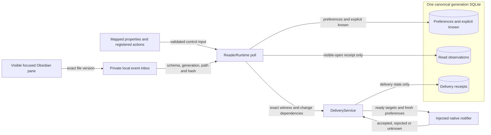

# Semantic reading consumers

This document owns the local reading projection, Obsidian controls, editorial
briefing and delivery contracts. These are source implementations; they do not
activate a generation, run a provider, install an Obsidian plugin or send a real
notification by themselves. The menu app remains the runtime owner.

## Integration API

All consumers share `ReadingLedger(connect, generation_id)`, where `connect()`
returns a fresh SQLite connection to the **canonical generation database**.
`reader_*` tables store consumer plans, preferences and receipts, never a second
Item or source truth. `ProjectionPublisher(ledger, vault_root,
current_revision=...)` requires a fresh canonical content-revision reader.
The root is the managed `WGO` directory, not the entire vault. File links are
root-relative and every filesystem operation rejects managed symlinks.

`ProjectionPublisher.for_store(store, managed_root)` creates the ledger on the
actual `SemanticStore.connect()` database and installs fresh revision/alias
readers. `CanonicalReadingAdapter(store).snapshot(item_id)` reads `get_item`,
`get_source`, canonical claim relations and resource associations under an
optimistic store-revision check. UTC epoch timestamps become UTC display
timestamps; source time and capture time are not interchangeable.

Each `EvidenceExcerpt` carries optional `speaker_id` and `speaker_name` from
`core.semantic.attribution.source_attribution(source_namespace, chat_id,
payload)`. This pure helper uses captured metadata only: an opaque ID identifies
the message speaker within its proved source scope, while the name is the
display label observed on that particular message. Names never join identities;
two people with the same name, or equal raw IDs in different source namespaces,
remain distinct. A raw account-ID fallback is not a display name. No contacts
lookup, historical-name inference, separate people database or identity-based
credibility score is introduced. A speaker may be forwarding someone else's
words: speaker, story subject and quotation author remain separate. Body and
Brief prompts preserve readable names when they explain experiences, positions,
corrections or stories, without requiring every sentence to name someone.

Fresh extraction pages use `unit_policy="retained-knowledge-v5"`. Content units
retain specific knowledge, meaningful wording and complete scenes. Pure
communication actions or isolated invitations without identifiable content may
receive a reasoned `context_only` disposition; raw messages and resource
references remain preserved. This is a semantic judgment, without length,
keyword or message-type filters; daily experiences, stories, gossip and reactions
with retained content remain eligible.

Fresh adjacent-context coverage binds `planning="pending-fragments-v1"` and the
exact `pending_span_ids` left unclassified by the primary pages. Terminal
classified fragments and already-cited spans do not reenter coverage core merely
because another fragment of the same message is pending. Every retained coverage
content unit must cite one of that page's pending core spans. Joint core/context
units, richer non-core Observation evidence and separately grounded typed claims
for withdrawal or restatement lineage remain valid. A core reference attached
only to the Observation cannot admit units grounded entirely in old context.
Invalid output uses the existing bounded correction loop before acceptance;
accepted content is never silently trimmed. None/v1/v2/v3/v4 pages retain their
exact frozen prompts, inputs and outcomes, including accepted artifacts that
would not pass the new admission rule. Unknown parent or child outcomes block
before another provider call; they never become fresh-policy replacements.

Reading policy is frozen per rebuild plan and generation. New plans bind
`reading_policy="editorial-composition-v1"` in the plan and generation
`metadata_json`; they use `body-plan-v14` / `body-paged-v14`. Previously bound
`source-composition-v1` and `content-responsibility-v1` continue to use v13 and
v12 unchanged. Missing policy fields
retain `derived-verbatim-v1` and the v11 writer, including its automatic literal
obligations for derived steps, counterevidence and units affected by withdrawn or
contested claims. These are four separate frozen contracts; resume never
upgrades an accepted, failed or unresolved historical invocation.
`bind_reading_policy(conn, binding)` is the canonical binding seam inside the
caller's generation transaction: first adoption requires every canonical and
reader table to be empty; subsequent calls must match the existing contract.
It never rebases a populated generation or changes an explicit older binding.
Old missing-field plans and metadata remain missing, preserving their original
fingerprints and prompt bytes. The adapter carries this binding in the snapshot,
and the writer checks it against the canonical ledger before reuse or dispatch.
The independent verifier checks manifest/generation policy agreement and accepts
v14 only for editorial composition, v13 only for source composition, v12 only for content responsibility, and v2-v11
only for the missing-field/legacy reading policy. It also checks unit homes,
evidence/resources, typed status and legacy literal obligations. None of these
structural checks proves natural-language semantic completeness or prose quality.

Editorial composition presents complete substantive `unit.text` responsibilities
as editable meaning, with role, evidence/resource handles, typed status/reason and
actual explicit `verbatim`. Complete original text/context, captured speaker and
source time remain attached to each evidence object. Offset-aware dated evidence
objects are directly sorted by source instant; full undated objects occupy a
separate `snapshot.undated_evidence` collection. Equal instants establish no
causality; undated list positions establish no chronology. This preserves source
and speaker bindings without asking the author to reconstruct order from a UUID
list. Ordinary requests, bounded pages and source windows use the same contract.

The editorial payload omits derived Item titles, Item kind/identity scope,
commit/known times and provenance audit labels. A minimal `binding` envelope
retains Item ID and content revision solely for the existing exact request/cache
identity; neither is prose material. Prior blocks retain their IDs, text and
unit/evidence/resource/status mappings without a second copy of Item/revision or
unit fingerprints. The full canonical snapshot, fingerprints and validator remain
program-owned. Canonical units, exact source pages, resources and claim obligations
are unchanged. Guidance begins with the thing itself: technical problems,
procedures, conditions, observed results and limits; life experiences and
meaningful reactions. It retains strong gender/attribution and grounded quotation
rules, without making derived responsibility wording literal. Structural tests
verify these inputs and recovery boundaries, not the author's semantic or
editorial success.

Under the retained source-composition policy, canonical units and their exact fingerprints remain
intact, including derived `unit.text` and the Item title. Only the model's
presentation payload omits these two prose fields (and related Item display
titles). It keeps unit index/ID/role, evidence and resource refs, typed status,
explicit `verbatim`, canonical identity scope and relations. Complete source
excerpts, context, captured attribution, source time and resource descriptors
remain available. The author reads these sources and writes the complete thing;
the same response maps content to the existing `unit_indices`. There is no
second draft/mapper call, inferred home or silently reduced responsibility.
Uncertainty, attribution, complete procedures and limits remain obligations.
Source-only guidance also forbids invented gender and repeating a paraphrase
followed by a full quotation; actual editorial acceptance still evaluates them.

The projection input is `ReadingSnapshot`: an explicit immutable presentation
snapshot containing canonical Item ID/content revision, semantic time, units,
evidence excerpts, available resource locations and typed relations. The
upstream caller supplies these fields from the canonical snapshot; these
dataclasses do not create Item/source schemas. `BodyPlanWriter` calls the
injected `TextProvider.generate(prompt, request_id=..., generation_id=...)`.
Its composition response contains only `blocks` with a stable `id`, `role`,
Markdown `text`, and `unit_indices` into the supplied ordered units. The program
binds Item identity/revision, unit IDs, evidence/resource associations and claim
statuses from the immutable snapshot, then validates the canonical `BodyPlan`.
Optional exact evidence markers add supplied supporting excerpts; unknown refs
still fail. Model-authored metadata cannot replace these bindings. Existing
injected full-BodyPlan callers and durable canonical artifacts remain readable,
and an explicitly wrong Item identity or revision still fails rather than being repaired.
Every unit has exactly one paragraph home. A block receiving no new or changed
units retains its previous bytes. A new immutable unit may be integrated into
an existing block by rewriting its automatic prose, while preserving the block
ID, all retained unit homes, evidence and resources. New details
that answer or qualify an existing explanation should be integrated at that
home, not automatically added as another chronological supplement. Other
independent parts of the Item may still use new blocks. Required verbatim fragments
and exact grounded quotations remain protected; an unrelated block cannot be
rewritten just because another block gained detail. This rule also applies to
bounded pages and oversized continuations. Under editorial composition, source composition and the
retained content-responsibility policy,
steps and counterevidence retain their complete substantive content, conditions,
order, scope and attribution without freezing the agent's derived phrasing.
Kind and claim status do not automatically populate `ReadingUnit.verbatim`.
Canonical content units currently have no explicit literal field to import, so
the adapter does not invent one. Actually supplied `ReadingUnit.verbatim`
fragments, including injected explicit requirements, remain exact obligations. The canonical adapter does not make every `quote` unit's whole message
mandatory body text: the writer may select a meaningful exact phrase or faithfully
paraphrase it, retaining attribution, uncertainty and the unit's evidence home.
Full original excerpts remain on the source pages. This avoids forcing chat
wrappers and repeated acknowledgments into prose; it does not drop canonical
units, evidence or resources. Injected explicit `verbatim` requirements remain
enforced. Retracted/contested claims become structured unit `status` and `reason`
inputs; their blocks must acknowledge that status and cannot remain current
conclusions. Original statements and evidence remain available. An
`evidence_only` observation contributes source evidence without adding new
narrative units. Claim and Item relation references resolve through their exact
canonical claim/observation/source/span identities. A correction recorded in
another Item, or not yet assigned to an Item, contributes its source excerpt to
the affected Item's bounded source pages without copying the other Item's body.
Evidence not already linked from a paragraph is reachable under supplemental
sources on the Item page.

Body block `text` is complete Markdown, not a forced prose paragraph. Writers
may choose headings, unordered or ordered lists, comparison tables, blockquotes,
inline code and fenced code when they help the material; ordinary prose remains
valid, and there is no required page template. Tables keep independent cases
separate and mark missing values unknown. Blockquotes must contain exact supplied
source wording; readable attribution belongs outside the quotation. Relayed
words retain their relay relationship and an unknown original author stays
unknown. Separate messages must not be joined into one contiguous purported
original quotation; each quote keeps its own source citation. Required original
wording and steps still belong to one stable unit
home, even when presentation adds quote prefixes.

The publisher owns the note title and frontmatter. The Body prompt therefore asks
for one coherent, reader-first entry, not a reader section per internal unit: a
leading H1 that merely repeats the note title is dropped from the published body
before writing (an exact match only, so required verbatim source headings, other
headings, blockquoted headings and fenced code are untouched). The prompt asks for the dominant language of the
supplied material, natural attribution of short inline quotes and substantial
display blockquotes, and no internal processing or schema commentary. A real
uncertainty or limit is stated only where it materially affects the reader.
Short conversational replies normally stay inline in the connected scene;
display blockquotes remain available when their form helps reading. Captured
resource labels or original filenames remain visible even while bytes are pending.
Factual prose must stay within the supplied units and evidence: the writer must
not add general background, feelings, motives or outcomes to pad a short note.
Questions, guesses and relayed speech keep their original uncertainty and
attribution. A brief source may remain a brief note without a generic opening
or a concluding lesson. These are writing constraints, not a claim that the
structural validator can prove every natural-language statement is grounded.

An optional `{{evidence:<span_id>}}` marker places a citation beside a claim or
inside a table cell. The program verifies the exact supplied evidence ID and
resolves it to a ready source page; wikilink aliases inside tables use `\|`.
Quoted wording is checked against its explicit citation, or against the block's
supplied evidence when no inline citation is present. In the latter case the
renderer adds a nearby source link with the captured speaker's display name.
A conventional named attribution line such as `—— 阿甲{{evidence:e1}}`, whose
prose names the supplied `speaker_name` of a cited excerpt, binds the quotation
to that exact citation: the renderer keeps the one explicit link instead of
adding a second source link, and a named quote whose cited excerpt does not
contain the words fails validation. An ordinary following sentence that merely
carries a citation stays a separate claim, never quote attribution. A captured
name on that attribution line must match the cited excerpt's captured speaker;
matching quoted words from another speaker do not repair an incorrect attribution.
Code fences preserve literal code, including text resembling citation markers.
Unclosed fences, invented references, ungrounded quotations, executable links
and machine-control markers fail validation. Ordinary headings, lists and quotes
are not rejected simply for being Markdown.

Production calls `publish_canonical_item(store, item_id, writer,
request_id=...)`. It injects the shared ledger into `BodyPlanWriter`, which
persists a validated result before publishing files. `reader_text_artifacts`
binds generation, exact prompt/snapshot, prompt version and provider route/model.
Accepted results resume without a second provider call. A request ID cannot be
reused for a different input or route; a running/unknown result cannot be
resubmitted under a new ID. For a complete response received from the bound
route, a known Body composition/validation failure may receive **one** automatic
repair. The failed row retains a small `received-validation-failure-v1`
diagnostic bound to its exact generation, prompt, request and route; it is not
an accepted Body artifact. The repair uses a deterministic `:repair:` child
request, recorded before dispatch. Its bounded prompt replaces only the generic
introduction with the validation code and keeps the complete snapshot, schema
and concrete writing/validation instructions. A lost-evidence diagnostic also
points the writer to the exact `unit.verbatim` obligation; it does not relax it.
Successful repair artifacts replay
without another call, including after a crash before file publication; the
original failed row remains unchanged. A failed repair stays exhausted on resume
or a caller's fresh request ID for the same input. Unknown/running outcomes,
wrong routes, provider failures, explicitly stale envelopes and historical
failed rows without this diagnostic never create a repair. A repair interrupted
after dispatch remains unresolved and blocks subsequent calls, including across
Body versions and page/fragment repartitioning. Calling the pure `plan` helper
without a ledger is intended for isolated rendering tests, not runtime
publication and does not perform this durable repair.
New editorial Body artifacts are `body-plan-v14` and `body-paged-v14`.
The bound source-composition policy continues to write v13,
the bound content-responsibility policy continues to write v12, and the
missing-field legacy policy continues to write v11. All ask for one
coherent reader-first note with grounded attribution, preserve each retained
unit's unique home, and carry the program-owned metadata and exact explicit
verbatim obligations and complete step/counterevidence responsibilities from
the canonical snapshot.
The prompt enumerates every required unit index: overlapping units may share
one prose block, but each still needs exactly one content home. Missing or
duplicated indices fail validation; the program never assigns a missing home
by guessing from similar text.
Retained source-composition inputs contain source excerpts with provenance labels,
unit responsibility metadata and explicit literal obligations, without a
machine-written unit synopsis or Item title to reuse. Frozen v11/v12 composition
prompts retain their synthetic technical/life demonstrations and original bytes;
v13 uses its own source-only writing contract. V14 reuses the pure synthetic
technical/life examples with editable responsibility wording. The examples are
not current evidence and cannot supply names or facts for the real note.
They are omitted from prior-plan and continuation work, preserving bounded context
for the actual material. This guidance does not change validation, authorize
rewriting accepted artifacts, or establish editorial quality.
Exact message times normally stay on source pages. If the body needs a time of
day to explain a change, writer guidance requires the supplied UTC offset;
it must not present a revision time as the event time or silently assume the
reader's local timezone. Editorial acceptance still checks the actual output.
Frozen v11-v13 writers receive `source_sequence`, a UUID list ordered only by
offset-aware source timestamps, and separate undated UUIDs. Their ordinary
evidence arrays retain their frozen order. V14 instead sends directly ordered
complete evidence objects and separately grouped complete undated objects.
Equal timestamps do not imply
causality, and unit order or commit order never establishes event order. This
input preserves the original unit indices, evidence identities and paragraph
homes; it supplies chronology for composition, not a new canonical clock.
Bare URL paths do not establish an unseen page's title, author or conclusions;
filenames do not establish attachment contents. Writer guidance preserves the
references without inventing a synopsis for unread material.
Both ordinary and repair prompts explicitly request a JSON object, including
localized writing instructions. This preserves the input requirement of
endpoints that enforce the JSON keyword when JSON-object mode is selected.
The paged aggregate key carries its policy's version, so a revised prompt never
resumes a paged plan produced by an earlier one. Accepted v2-v13 artifacts remain
historical evidence under their original contracts; these prompt instructions
are generation guidance, not proof of editorial acceptance or owner review.
Before dispatch, the writer also checks unresolved page/fragment descendants of
the stable request ID across Body versions. A new prompt or context budget
cannot bypass an earlier unknown outcome by choosing a different partition.
The verifier accepts v14 forms only for editorial composition, v13 only for source composition, v12 only for the
bound content policy and retained v2-v11 only for the legacy reading policy.
Its allowlist remains in lockstep with the writer; this prose does not authorize
rewriting accepted historical output or weakening the verifier.

`BodyPlanWriter(..., max_input_bytes=80000)` keeps small Items in one coherent
writing call. Larger inputs use bounded pages of consecutive units and existing
paragraph homes, with only their associated evidence/resources. Unaffected
paragraphs bypass provider work and retain their exact bytes. New paragraph IDs
are assigned from their canonical unit homes to avoid collisions across pages.
Each page and the validated aggregate plan are durable before file publication;
the aggregate validates every unit exactly once, stable previous homes,
verbatim obligations, claim status and references. A single oversized paragraph
uses bounded continuation tasks: all unit, evidence and context text is supplied
in ordered segments, then accepted prose joins at one stable home.
Editorial and retained source-composition modes budget their actual presentation
payloads. V13 hidden derived text cannot force pages or echo calls; v14 complete
editable responsibilities count toward that budget. Ordered source windows first pack adjacent
complete excerpts with their context
under the actual prompt budget; several sources may share one writing call and
one original home. Only a source that cannot fit alone is split into paired
text/context segments. Core windows retain unit mapping and status checks;
context-only tails have no required units and must return no new narrative.
Context supports its source instead of becoming a second content/home obligation.
V13 windows do not fall back to hidden derived prose. V14 supplies full editable
responsibilities beside the source windows; oversized responsibility text is
supplied completely in ordered, nonliteral slices, consumed successively alongside
source windows. Remaining responsibility slices continue at the same home without
duplicating all source windows. This is one bounded continuation owner, without a
second writer/mapper stage or a responsibility-by-source cross product. Context-only
tails with no required units still return no narrative. Exact explicit literals
retain their strict accepted continuation path. Truly indivisible metadata that
cannot fit the actual prompt budget fails closed rather than being truncated.
Supplemental sources/resources accompany the first group that needs writing, even if earlier
unchanged groups bypass the provider. A unit with no source material,
resource or explicit literal fails before dispatch rather than creating an empty
call. Frozen v12 derived continuations remain editable under their original
contract, and v11 retains its exact-text continuations. Actual explicit literals
not already preserved require strict accepted literal continuations at that
same home, including literals larger than one page. The
program cannot fill omitted literal output itself. Original verbatim fragments,
status and resource associations remain bound to the complete unit.
The effective budget never exceeds an injected provider's declared input limit.

`ProjectionPublisher.publish_item(snapshot, plan)` publishes bounded source
pages first, then the one Item file. `publish_view` contains links/embeds, never
copies Item paragraphs. IDs determine original filenames; later titles do not
rename files. `wgo_id` scanning discovers user renames; duplicate identities
fail closed. `resolve(id)` and `ready(id, revision)` recheck disk state.
Structured body anchors sit on their own line with blank lines around them,
immediately after the actual table, list, quote or code block, before generated
source footers. This follows Obsidian's [block-link rules](https://obsidian.md/help/links).
Multiple unplaced citations use a collapsed native Obsidian source callout below
their block. Each exact evidence link remains available when expanded; explicitly
placed citations and actual resource links remain in their reading positions.
A single supported Markdown block can be [embedded](https://obsidian.md/help/embeds)
in a View, with source links beside the embed. A compound BodyBlock containing
several Markdown blocks uses a stable navigation link instead: one block ID
cannot honestly stand for an entire compound section. Retraction/correction
status also stays reachable through the full Item link. Views never copy the
body into another file. Source-page anchors similarly target the exact fenced
excerpt, before optional context. Captured source text stays literal inside a
sufficiently long fence; its own Markdown, checkboxes and control-like text
cannot become controls. Source captions identify the message speaker/forwarder,
not an inferred quotation author. An exact pre-attribution source-render cache
can gain this caption as a render revision; changed excerpt bytes cannot use
that upgrade path. Personal text and all existing publication protections apply.
Merged identities publish an ownership-protected redirect; split identities
publish a multi-target selection page. Restored identity operations use the same
alias mechanism. These pages contain links, never a second active Item body.
Publish active successor Items first. Click resolution follows logical aliases
and discovers renamed files, using the split page when several targets exist.
After the exact current projection is ready, its outbox row is acknowledged with
a file receipt. The store can then mark older pending projection rows
`superseded`; old revisions are never falsely acknowledged as published.

`ReaderControls` registers the fixed `检索.md` and `管理.md` pages. The query
callback is injected. `CoreSearchAdapter(store, HybridRetriever(store))` connects
the real core retrieval callback, resolving source/observation/claim/relation
hits to canonical Item links and displaying incomplete coverage honestly. Query
versions and answers are recorded in SQLite and immutable `检索记录` pages.
Changing a generated answer cannot trigger the query again; a changed input
property creates a new query revision. Explicit property mapping reserves
non-`wgo_*` keys; existing user fields, including null values and quoted keys,
cannot be claimed accidentally. Management checkboxes
execute only exact pre-registered hidden action IDs inside its own region.
Actions bind target Item/content/preference revision and current file hash.
Refreshing the management page preserves validated checked actions until they
are durably consumed, including when source publication runs before the reader
poll. Checked stale actions remain visible for explicit rejection; unchecked
obsolete actions are superseded. A refresh never executes an action.
`observe_open` accepts an explicit visible-open observation; delivery acceptance
and modification times cannot mark read or known. `mark_known` records only the
displayed content version. Preferences never change source rows.

`BriefingService` accepts before/after `BriefChange` snapshots and invokes one
cross-Item editorial TextProvider step. The JSON `BriefPlan` contains its final
paragraphs plus exact supplied change/evidence references. One timezone-local
day has one stable edition and one file. Receipts distinguish `success`,
`silent`, `review` and `deferred`. Historical edition text is frozen text, not
an embed of a live Item. Source time and learned time remain separate.
`BriefChange.attributions` contains exact evidence ID, opaque speaker ID,
captured name and excerpt records. On a canonical generation,
`BriefingService` reconstructs these from the given source spans and records;
caller-supplied identity claims cannot override them. Source-free explicit
snapshots may supply the same fields. The editorial and final writing steps see
the attribution, preserve separate same-name cases and do not turn a forwarder
into the original speaker. Brief paragraph text uses the same Markdown,
quotation validation and table-safe citation rendering as Body blocks.

`SemanticRuntime.brief` constructs these inputs from actual canonical deltas.
For an Item's first edition consideration, the baseline is the revision before
its first change on that local day. Later considerations start from the last
successful or explicitly silent edition input for that Item. An unchanged
latest change reuses the same retained input. A late continuation therefore
supplies only affected units; a single large source committed in several
canonical transactions still contributes all its parts. Navigation/provenance
updates with semantic effect `none` cannot hide earlier meaningful changes.
Claim status and exact transaction claim relations contribute grounded
correction, scope and condition fields even when the old quotation is unchanged.
`BriefChange.before_revision` and `contributing_change_ids` bind the exact
revision interval; the main `id` remains the latest canonical change ID and
`content_revision` the current Item version. Direct callers may omit the two
additional fields when supplying one exact change.

Small inputs combine editorial selection and writing in one call. Larger inputs
use bounded, hierarchical TextProvider selection pages, followed by one coherent
writer across the selected changes. `max_input_bytes` defaults to 24,000 UTF-8
bytes per prompt. Every page treats all content kinds equally; there is no
technical quota, and life stories may lead or occupy the entire edition. Each
selection must return exact supplied change IDs and a reason; every accepted
selection is durable before the next stage. The final writer aims for about 900
Chinese characters with a soft 1,800-character upper target, without padding.
An individually large change first passes through consecutive field fragments,
then bounded editorial merge pages. Every before/after character, constraint
and evidence ID enters a page; program-assigned contiguous coverage and exact
change/Item/revision bindings are validated. No source text is truncated to make
the prompt fit. Accepted editorial material feeds the final cross-Item writer.
Long scope/correction fields use bounded handles during writing and are restored
in full before final validation; supplied conditions also remain intact in the
historical edition. `reader_brief_inputs` retains complete redacted inputs and
attribution excerpts, including every consecutive fragment of a long excerpt.
Bounded final writer inputs retain the selected evidence's name/identity
metadata; final quotation validation uses the complete retained source excerpts.
The same ledger also retains
preference/known/content bindings before any page is invoked. Explicit manual
inclusions that cannot fit the final editorial selection still receive a
deferred receipt rather than being silently omitted.

Mute, known and manual exclusions are applied before any prompt. Explicit manual
inclusions cannot be dropped by selection or by a silent writer result. The
program validates every paragraph's change/evidence references and retains exact
scope/correction fields and supplied conditions. A successful validated
`BriefPlan` is accepted as `reader_text_artifacts` prompt version `brief-write-v3`
and immediately stored in `reader_brief_attempts`; file/evidence
publication failures resume that artifact with zero new provider calls. The
input hash binds `brief-plan-v3`; bounded preparation stages use
`brief-compact-page-v2`, `brief-compact-merge-v2` and `brief-select-v2`.
A crash between accepted pages or
between writer acceptance and edition publication resumes those exact artifacts.
An actual running/unknown provider attempt remains blocked, including under a
new request ID. Provider
failure and editorial silence are distinct receipts and retain the last
successful edition. A manually adopted pending edition is finalized on the next
`build` call using the accepted result, preserving its edition ID and historical
versions. Pure rebuild uses stored successful text and never invokes a model.
Edition content revisions bind the successful plan and its exact selected
contributors, even when a new version happens to use the same prose. Renaming a
link alone is a render change, not another unread content version.

`DeliveryService` persists stable attention events and device/channel attempts.
It validates content/preference versions and required Item/evidence projections
before invoking an injected capture notifier. Rebuild is silent by default.
Unknown outcomes require reconciliation of the exact receipt; they cannot be
resent. Accepted delivery is neither an open observation nor known state.
Click targets are logical IDs resolved at click time inside the managed root.

## Source-independent reader and visible opens

The app composes `ReaderRuntime(semantic_runtime, *, notifier=None, device_id,
live=False)` from the already configured `SemanticRuntime`; the app owns its
daemon timer and persistent device ID. `poll()` performs property sync,
registered management actions, query execution, visible-open inbox consumption,
`WatchService.sync_reader_watch`, witness evaluation and attention bridging.
It returns content-free counts and bounded status codes. It does not capture
sources, publish Item bodies, build an index or build a brief. Those remain
separate runtime jobs, so no new source message is needed for a query, preference
edit, explicit known action or visible-open receipt to take effect.

`semantic_reader_properties` may be empty or contain overrides for `follow`,
`mute`, `wait` and `query`; omitted roles use `阅读关注`, `阅读静音`, `阅读等待`
and `查询`. Final keys must be distinct, supported non-`wgo_*` scalar keys.
`ReaderControls.property_mapping` normalizes these defaults for both first
publication and subsequent `ReaderRuntime` polling. A custom query key is
registered on first publication; changing an already registered mapping fails
explicitly instead of silently adopting another field. Unregistered existing
fields are never adopted. Applied management preference
actions update only these mapped properties so the next property poll cannot
undo them. `WGO/阅读状态.md` is a separate projection of watch state, unknown or
contested evidence, review due and bounded event errors; it does not own or
overwrite management actions.

This source-level flow shows the three distinct state owners; it is not evidence
that the optional plugin or native notifications have been activated:



The optional desktop plugin source and manual installation instructions are in
[integrations/obsidian](../integrations/obsidian/README.md). No plugin is installed
or enabled by this implementation. It checks a loaded active `MarkdownView`,
the owning document's visibility and focus, visible pane geometry, exact visible
text and current regular file bytes. File-open commands, notification clicks and
mtime are not read observations. It writes only Item/brief events under
`WGO/.wgo/reader-events/<32-hex-event-id>.json`, through a private temporary file
followed by an atomic rename; the event contains no note text.

The exact event schema is `wgo.reader-visible-open.v1`, with `schema`, `event_id`,
`generation_id`, `item_id`, positive integer `content_revision`, WGO-relative
`path`, `file_sha256`, UTC epoch `observed_at`, literal
`origin: obsidian_visible_open` and `visible: true`. Extra fields, stale or
unknown generations/versions, wrong identities, changed hashes, unsafe paths,
symlinks, non-private/non-regular events and payloads over 8,192 bytes fail closed.
At most 128 new events are consumed per poll. Python checks the actual file,
canonical historical revision and trusted projection before recording read.
An older still-displayed canonical version records only that version. Accepted
events receive a durable consumer receipt before moving to `processed/`; a crash
between those steps resumes without another read. Invalid originals are retained
and reported with bounded content-free codes. This is a trusted local-file
protocol, not cryptographic authentication against other code running as the
same OS user. Current plugin private-permission support is POSIX desktop only;
Windows DACL and live desktop acceptance are separate gates.

`deliver_changes()` emits only exact wait met/reopened or explicitly followed
correction candidates. Ordinary followed updates belong in the brief. Clearing
follow/wait stops future watch evaluation while retaining history, and mute wins
over both. Every correction above the delivery floor is considered even when
the same Item has a later ordinary or provenance-only revision before polling.
An unsent correction uses the current ready Item and exact claim evidence;
accepted, rejected, unknown or in-flight delivery retains its original event and
receipt for that device/channel across later revisions and restarts. A correction
already covered by the reader's known revision is not new attention.
`deliver_brief(BriefReceipt)` requires the current successful edition
receipt and derives its exact contributing Item revisions and evidence from the
stored successful plan; it never reconstructs those dependencies from links or
counts. Immediately before delivery, mapped preferences are synchronized again,
then DeliveryService verifies current content/preference versions and every
required Item, edition and source projection. Accepted, unknown and in-flight
attempts cannot be replayed as fresh sends.

The active generation's `metadata_json.delivery_floor_change_id` is an integer
set by the activation coordinator to the last historical canonical change. A
missing floor suppresses all reader attention. Only semantic changes above it
can enter immediate delivery; briefs must actually select at least one such
change. Historical rebuild/startup alone therefore produces zero notifier calls.
`live=False` additionally records silent dispositions. The app injects native
notification/open handling; click callbacks resolve the logical event target
through `DeliveryService.resolve_click()` at click time, including aliases and
user renames. None of those delivery operations records read or known state.

## Ownership and recovery

Only `wgo_*` frontmatter and named `<!-- wgo:begin ... -->` regions belong to
the machine. Unknown YAML, title text and all other bytes are preserved. Every
write starts from current disk bytes and uses serialized atomic publication
with an expected-content check. Content, render and annotation revisions are
separate. A render change does not update semantic time, known state or notify.

Unrecognized legacy files and modified machine regions are never guessed safe.
The consumer saves a complete backup, a pending draft and a separate short
status page. Management offers three registered actions: adopt the new draft,
move the edited machine text to personal notes then update, or retain the
personal version. A stale proposal/version/hash is rejected. An intentionally
personal version does not masquerade as a current machine projection.
Pending brief actions additionally bind all contributing Item/content,
preference and known revisions; pending query actions bind the input property
and result revisions. A newly muted Item or a changed query cannot be revived
by adopting an older draft. Moving a personal rewrite into notes and installing
the accepted machine text uses one atomic replacement. The projection receipt
and proposal disposition commit in the same SQLite transaction.

URL rendering and prompts use `core.url_safety`; source excerpts keep necessary
context and stable anchors. Labels distinguish raw exact excerpts, retained
excerpts with incomplete context, derived summaries and personal annotations.
Old source anchors remain available after later Item edits. The source page
cache is a bounded render of canonical evidence, not an independent fact store.
Resources retain their relation when bytes are
pending; links require a verified regular local file in an explicit allowed
root. Evidence pages are bounded by count and size and must be present before
their Item/brief projection is acknowledged. No plaintext source configuration,
chat export, provider credential or live notification is needed for verification.

## Synthetic verification

Run from the repository root using its test environment:

```bash
python -m unittest tests.test_semantic_projections tests.test_semantic_controls tests.test_semantic_briefing tests.test_semantic_delivery tests.test_semantic_reader_runtime
```

The fixtures use temporary databases/vaults and scripted providers/capture
notifiers. They cover the Friday-box/Saturday-noodles/Sunday-repost/Monday-window
story, exact personal ownership and stale actions, real canonical store and
search adapters, renamed identities and split hubs, source grades and claim
status, bounded cross-Item editorial selection, accepted-artifact crash recovery,
bounded Item-body pages and lossless oversized-unit continuations, the real
source-independent controls/watch/attention composition, more than 100 KB of a
single story through actual canonical extraction/body/brief publication, late
delta-only writing, pure claim corrections and custom query first publication,
and delivery/read/known
separation. The Node test mocks Obsidian's actual-view APIs and uses a temporary
vault to check visibility, focus, exact file bytes and private atomic events;
if Node is unavailable it is explicitly skipped. They do not establish installed Obsidian UI
observation, macOS notification behavior, activation or live-source acceptance.

Canonical fact/job contracts are in [semantic-store-contract.md](semantic-store-contract.md)
and [semantic-engine.md](semantic-engine.md); these consumers do not replace
those owners or restore MCP message sending.
