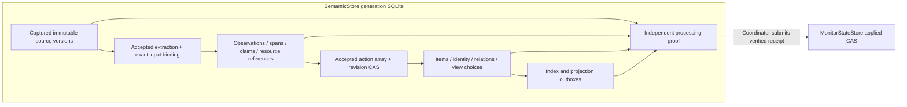

# Canonical semantic generation store

`SemanticStore(path, generation_id, now_func=time.time)` creates/opens one private
SQLite generation. `connect()` returns a new Row connection with foreign keys;
`transaction()` owns BEGIN IMMEDIATE/commit/rollback. No provider work belongs
inside a transaction. Main configuration, monitor checkpoint and provider usage
remain outside this owner. This is source implementation, not live acceptance.
This schema is a fresh candidate generation schema; opening a different schema
or generation fails before DDL. It is not an in-place upgrader for a deployed
knowledge database. Symlinks and non-regular database paths are rejected.

All public payloads below are dictionaries; IDs are strings. Errors expose only
`SemanticStoreError.code`. `get_item`, `list_items`, `get_observation`,
`get_source`, `get_batch`, `list_batches`, `read_revision` and `documents` are
read APIs. `get_item` includes observations, claims, units and relations. JSON
columns end in `_json`; read APIs decode them to their names without that suffix.
Multi-query reads hold one SQLite read snapshot and close their connection.
Capture, extraction, Item/claim/identity and view definition/override changes all
participate in the generation revision. Jobs, provider calls and projection ACKs
do not make content fresh. Read APIs preserve canonical bytes and permissions.



## Capture and extraction

`capture_batch(batch_id, records, *, source_namespace, chat_id, inventory_digest,
inventory_revision, input_cursors, output_cursors, source_eof, purpose="live")`
returns a durable receipt dict containing receipt_id/batch_id/member_version_ids,
generation_id and both vectors. A record has `source_id`, `logical_shard_id`,
`physical_generation`, `source_cursor_token`, `source_sent_at`, `text`, optional
`payload` (exact original message), `kind`, `provenance_grade`, `native_revision`,
`core` (default true). Re-observation of the current payload adopts its current
version; A→B→A produces three versions. Reusing a batch ID with changed input
fails. A native revision may identify only one transition, including across
nonadjacent A→B→A transitions. For legacy imports the namespace and provenance must explicitly identify
legacy material; no raw-exact claim without source evidence.

Optional record `resources` (also admitted from exact `payload.resources`) is a
list of `{resource_id,occurrence_id,purpose,status,location,metadata}`. IDs,
purpose and status are nonempty strings, location is null or a nonempty string,
and metadata is an exact JSON object. Resource references participate in the
source content hash. The store preserves these fields without opening files,
fetching URLs or claiming attachment-byte availability. References persist in
`source_resource_refs`, then flow only from cited versions to Observations and
their attached Items. `get_source` and `get_batch` expose `resources`.

`get_batch(id)` returns binding fields plus `members`: decoded source records
with `core`. **Engine source IDs are `source_version_id`**, not occurrence IDs.
Each source row has immutable occurrence `source_id`, transition `revision`,
source/capture times, payload/text/hash, superseded version and capture_seq.

`commit_extraction(job_id, batch_id, observations, dispositions=None)` requires
a valid accepted `extract` job. Its immutable inputs are
`{batch_id,members:[{source_id,text,core,occurred_at,reply_to,case_id,material_id,
subject_id,speaker_id,speaker_name}]}` under prompt version
`semantic-extraction-v2-attribution`; source_id is a version ID. The nullable
speaker fields must be present and exactly match the shared pure
`captured_source_metadata` / `source_attribution` helpers. Version, original
text, core flag, time, anchors and attribution must match the captured records. The accepted
artifact's `observations` and `dispositions` must match the exact commit request.
Observations have the current engine dictionary
shape (`observation_id,title,scene_kind,spans,units,topics,claims`). A span has
`span_id,source_id,start,end,excerpt`; source_id references a captured version.
The program generates 2000-character spans over URL-redacted text, with UUID5
identity over `[generation_id,source_version_id,start,end]`; exact visible bytes
and the mapping back to raw offsets are checked. Each Observation must cite at
least one effective core member. One core source may yield zero, one or many
Observations. Every unit and claim cites existing spans in that Observation;
verbatim quote units must actually occur in a continuous same-source cited
interval. Adjacent spans may form that interval; gaps and cross-source
concatenation are rejected. Canonical `redact_urls_with_offsets` supplies exact
replacement ranges once per source, preserving display bytes without quadratic
whole-text diffing. Explicit subject anchors use only `subject_anchor` and
retain namespace/chat scope. An opaque speaker ID derived from `raw_sender_id`
is namespace scoped; local `sender_id` needs captured shard evidence and keeps
namespace/chat/shard scope. Display names remain per-source labels, never
identity keys, and raw account-ID name fallbacks stay private. A claim's
subject may be an explicitly supplied subject or the speaker for a supported
first-person self-report; no automatic assignment occurs. Subject, speaker and
case candidates must belong to the claim's cited sources. Empty bodies,
conflicting Observation/unit/claim identities, unknown anchors and ungrounded
claims fail the entire transaction.

The only previous prompt accepted at canonical commit is the explicit
`semantic-extraction-v1` frozen-artifact recovery boundary. Its original
subject fallback and absence of speaker metadata are verified as that old
contract; it is never rewritten into a v2 job. Other/omitted prompt versions
fail with `extraction_prompt_version_conflict`. The engine's candidate-only
recovery and removal condition are described in
[semantic-engine.md](semantic-engine.md). No person database or live schema
migration is introduced by attribution. Independent rebuild verification
recomputes extraction and Brief attribution from captured payloads rather
than trusting a provider artifact's names or IDs.
Claim `observed_at` must equal a source-sent timestamp of one of its cited spans;
an arbitrary finite future timestamp cannot become post-recovery evidence.
Narrated earlier stages stay in the supported condition/phase/predicate fields.

Dispositions map version IDs to `{status,reason}`. `observed` is program-derived
from exact Observation evidence; other supported statuses are `context_only`,
`repetition_only`, `noise`, `unsupported_type`. `unclassified` remains pending and
cannot ACK source progress, even if another page has already cited the same
source in an Observation. Complete source coverage wins over a partial hit. A second captured batch adopts the unique existing
`source_core_jobs` owner. It cannot create independent evidence or rewrite that
owner's dispositions. Context alone cannot introduce a new Observation.
An accepted empty extraction needs explicit dispositions for all effective core
inputs before completion. This API writes an extraction receipt, a typed
`COMMIT_EXTRACTION` canonical transaction and Observation index outboxes in the
same transaction. Extraction itself is not semantic source ACK.

## Actions and receipts

`apply_proposal(job_id, actions, *, read_set, decision=None)` requires an accepted
`propose` job artifact. Its inputs contain `state.read_set`, `state.observations`
and `state.items`; accepted `read_set` and the actual request must be identical.
The program validates canonical Observation content and candidate identity
fields even when a bounded resolver omits verbatim spans or uses a separately
accepted candidate digest. Actions cannot attach unprovided Observations or
refer to unprovided claims. Optional `decision` must equal a second accepted
`decision` artifact with `choice="apply"`; that job binds `proposal_job_id` and
the complete exact accepted proposal artifact. A program-mediated derived
decision may reuse a previous accepted choice only after validating the exact
mechanical mapping; merely passing a success flag is insufficient.

Resolver proposals can become stale after their accepted artifacts are durable
but before canonical commit. A committed replacement may supersede only an
uncommitted `propose` job with the exact same batch and incoming Observation
IDs and an older canonical read revision. In that same replacement transaction,
`proposal_supersessions` records both artifact hashes and read sets, the stale
reason, exact source/extraction lineage, the replacement receipt, historical
resolved Item memberships, and their canonical transaction/outbox sets. Every
input Observation must actually be resolved. An unrelated plan, partial
resolution, pending replacement, or unknown/running decision is not proof.

The original proposal and its accepted decision artifacts remain immutable;
their jobs become `done` with a `supersession_<proof hash>` receipt. This receipt
means the stale computation was reconciled, not that its original actions were
applied. `proposal_supersession(job_id)` reconstructs the proof and returns the
actual committed replacement receipt, or `None` when no proof exists. Normal
replay can adopt that receipt without another provider call. Independent
acceptance reconstructs the same evidence from SQLite and still blocks missing
or invalid supersession evidence and unknown outcomes.
`JobStore.finish_applied_proposal(job_id, receipt_id)` finishes the actual
committed proposal and exact accepted choice together. Adopting a supersession
also calls it, so a crash after replacement commit cannot leave its already
applied jobs permanently pending in health.

read_set is `{store_revision:int, items:{id:revision},
views:{id:{definition_revision:int,override_revision:int}}}`. CREATE/MERGE/SPLIT
require exact store_revision as well as targeted read revisions. The complete
action array is atomic, including view/user overrides and optional claim
relations. Booleans are not revisions. Each action has unique `action_key` and `type`:

- CREATE_ITEM: item_id, kind, title, identity_scope (dict), observation_ids.
- MERGE_INTO_ITEM: item_id, observation_ids, modes (one or more of append_detail,
  add_evidence, correct, refine_scope, continue, attach_resource), semantic_effect
  (none/detail_added/evidence_changed/state_changed/scope_changed/continuation/
  resource_arrived), optional title. Replay with effect none never refreshes time.
  New provenance attached with `none` has role `evidence_only`; it does not add
  semantic units to Item body. A changed provenance set gets a new content
  revision without refreshing semantic time; a pure repeated attachment does
  neither. `get_item.observations[].role` and `get_item.claims[].role` expose this
  distinction; `get_item.units` excludes evidence-only Observations.
  `list_claims.item_roles` maps Item IDs to their exact roles; evidence-only
  attachments do not become independent semantic witnesses.
- RELATE_ITEMS: from_item_id, to_item_id, relation, reason, evidence_ids (list),
  direction (directed/symmetric). No identity merge is implied.
- ADD_MEMBERSHIP: item_id, view_id, placement, origin (model/rule/user), reason;
  optional pinned/excluded only for explicit user origin.
- MERGE_ITEMS: item_ids, target_item_id, reason; all inputs preserve lineage.
- SPLIT_ITEM: item_id, outputs (CREATE_ITEM-shaped dictionaries), reason;
  every source observation must remain assigned to at least one output.

Every action may include `claim_relations:[{from_claim_id,to_claim_id,relation,
reason}]`. `from` is an incoming exact claim; `to` is a supplied affected claim.
Both evidence and claim references must exist. The explicit standalone API is
`record_claim_relation(from_claim_id,to_claim_id,relation,reason="",
expected_revision=None)`. Ordinary relatedness does not imply withdrawal:

- `corrects_or_retracts`, `corrects`, `retracts`: mark the target retracted,
  preserve its text/evidence and append its ID to the source claim's `retracts`.
- `disputes`, `contradicts`: mark the target contested, without reviving an
  already retracted target.
- `same_material`: unite material families, including existing members of both
  families, without creating independent evidence or refreshing semantic time.
- `related`, replay/restatement, support, scope, time and unresolved relations
  keep their explicit meanings; only the withdrawal/dispute variants above
  change target status. Corrections invalidate the target's material witnesses.

All Item memberships of affected claims and their directed dependencies are
enumerated without a ranked-search cutoff. Content revisions, snapshots,
change_events and both outboxes commit together. Related dependants become dirty
without acquiring a fabricated new semantic time. Structural changes use effect
`none`; their new revision is distinct from semantic freshness.

Return receipt_id, transaction_id, outbox_id (transaction compatibility handle),
outbox_ids (actual durable outbox IDs), affected_item_ids and store_revision.
Replaying the same accepted actions adopts this receipt. Changed actions under
the same job/action key fail. Each changed Item has content_revision and
semantic_updated_at, version snapshot and change event. Navigation membership
does not update semantic freshness. Directed relations and all affected Items
remain available to retrieval independently of ranked search limits.

Identity MERGE/SPLIT preserve source evidence, claims, observation roles,
resource references, memberships, original relations and outgoing alias paths.
Split outputs collectively cover exactly the original Observation set. Related
views must be in the read set. Conflicting explicit user placements/pin/exclusion
choices block MERGE rather than choose one silently. Retired IDs stay as real
redirect/split hubs, and alias cycles are rejected. The operation stores full
before/after associations and a fingerprint of its exact resulting identity.

`restore_identity_operation(operation_id,expected_read_set)` writes a new
compensating canonical receipt and new revisions; it does not rewind the entire
database or delete raw source/claim/history rows. It requires current global,
affected Item and affected view revisions, and the operation's association
fingerprint must still match. Later identity/body/user-choice changes therefore
require their own deliberate resolution, not a blind restore. Merge restores
the original active IDs and associations. Split restoration keeps the output
IDs as `restored` redirects to the original identity. `identity_restorations`
binds one exact compensation; replay with its exact original read set adopts it.

`create_view(view_id,title,definition,*,origin="user")` creates a definition;
`update_view(view_id,definition,expected_revision)` revises it. `get_view` returns
definition_revision/override_revision. `pending_outbox(kind,limit=100)` and
`ack_outbox(kind,outbox_id,owner_id,revision,receipt_id)` bind exact revisions.
Projection ACK also requires the current Item revision. After a real latest
projection ACK, `supersede_projection_outbox(owner_id,published_revision,
receipt_id)` can mark older pending projection jobs `superseded`. Their evidence
binds the exact higher-revision done receipt. Index jobs and historical Item/
source/brief versions are retained; projection supersession is not an index ACK.
`complete_batch(batch_id)` verifies all core dispositions and every observed
Observation's canonical Item membership, then writes a processing receipt with
canonical/outbox references. It blocks behind earlier unprocessed core batches
in the same namespace/chat, and never advances MonitorStateStore itself.

`verify_processing_receipt(receipt)` reads the database independently of the
producer's counters. The exact proof is:

```python
{
    "core_sources": [{"source_version_id": "…", "job_id": "…",
                      "status": "observed", "reason": "…",
                      "extraction_receipt_id": "…"}],
    "observation_memberships": [{"observation_id": "…", "item_id": "…",
                                "revision": 1, "transaction_id": "…"}],
    "extraction_receipt_ids": ["…"],
    "canonical_receipt_ids": ["…"],
    "outbox_ids": ["…"]
}
```

The receipt includes `proof`, its canonical JSON SHA-256 `proof_fingerprint`,
the three ID arrays at top level, capture_receipt_ids, generation_id and the
exact input/output cursor vectors. Membership uses the durable historical Item
revision at completion so later legal changes do not invalidate a previous ACK.
Accepted inputs, source dispositions/core ownership, canonical transactions,
action receipts, Item revisions/change events and real outbox rows must still
exist and agree. Pending projection delivery or human-edit conflicts do not
block semantic completion. Missing evidence blocks completion and receipt replay.
The processing transaction has one typed `COMPLETE_BATCH` action and references
the real outbox IDs; a transaction ID is never substituted for an outbox ID.

`record_migration_receipt(receipt,processing_receipts)` verifies every referenced
processing receipt in one canonical transaction. It binds exact generation,
migration/capture/processing IDs and persists `semantic_migration_receipts` plus
a typed `MIGRATION` aggregate whose outbox references are the exact union of the
verified children. Old checkpoint/pending coverage and H1/source-snapshot proof
remain the rebuild coordinator's responsibility; this API does not self-certify
those external facts or install a monitor checkpoint.

## Jobs

`JobStore(store)` uses the same database. `ensure(kind, inputs, versions) -> job`
binds complete source/version/profile/prompt inputs. `claim(job_id,worker_id,
lease_seconds=300) -> job|None`; `accept(job_id,worker_id,artifact,*,validate,attempt=None) -> artifact`;
`accepted(job_id) -> artifact|None`; `fail(job_id,worker_id,code,unknown=False)`;
`finish(job_id,receipt_id)`. One validated accepted artifact per exact job;
lease expiry permits another attempt, never overwrites an accepted result.
`renew(job_id,worker_id,attempt=None)` renews an owned running attempt while it
waits for provider admission. `defer(job_id,worker_id,evidence,attempt=None)`
returns only a scheduler-proven unsent attempt to `pending`, retaining its
attempt record. It requires that exact job/request binding and no accepted
artifact; an arbitrary provider error or `outcome_unknown=False` is not proof.
The mandatory callable `validate` returns the strictly validated dictionary;
raw model strings and an absent validator cannot be accepted. Attempts fence
stale workers, including a restarted process using the same worker ID. An
accepted artifact is immutable. `finish` checks a canonical/extraction/processing
receipt belonging to the job, or the exact proof produced by
`accepted_artifact_receipt(job_id,artifact)` for pure computation jobs.

Unknown sent outcomes never expire into another provider call. Explicit
`reconcile_unknown(job_id,evidence_receipt,*,validate,artifact=None,
validate_artifact=None)` requires a validator for external evidence and persists
that evidence. The receipt has schema
`we-groupchat-obsidian.semantic-job-reconciliation.v1`, receipt_id, generation_id,
job_id, job_key, attempt, worker_id, request_id, provider_receipt_id, outcome and
artifact_hash. `not_sent`/`failed` permit a new attempt; `completed` additionally
requires the exact artifact hash and an artifact validator. The coordinator
verifies the provider evidence; the database does not claim to authenticate a
remote provider from an arbitrary success flag.

## SQL ownership

Core tables: generation_manifest; source_records/source_heads; capture_batches/
capture_batch_members; source_spans; observations/observation_evidence;
content_units; entities/entity_aliases; claims/observation_claims/claim_relations;
cases/evidence_witnesses; items/item_observations/item_claims/item_revisions;
item_relations/item_aliases/identity_operations; views/view_memberships;
source_resource_refs/resource_refs; jobs/job_attempts/job_reconciliations/
accepted_job_artifacts; source_core_jobs/source_dispositions;
extraction_receipts/processing_receipts/semantic_migration_receipts/action_receipts;
canonical_transactions/decision_log/proposal_supersessions; identity_restorations; change_events;
projection_outbox/index_outbox; legacy_mappings/annotation_preservation.

`documents()` yields `{owner_type,owner_id,revision,text,metadata,capture_seq}`
for source, observation, Item and relation objects, including unresolved material.
Retrieval owns embedding_records/index_profiles/index receipts in this same DB;
watches own their state/episode tables; reading consumers own reader_* tables.
They consume canonical IDs and connection, never create another facts database.
Canonical association and receipt references use foreign keys; references that
are created in the same transaction use deferred constraints. Auxiliary owners
must not bypass accepted-artifact, Item revision or receipt methods with direct
canonical SQL writes.

Focused synthetic verification: `python -m unittest tests.test_semantic_store
tests.test_semantic_jobs tests.test_semantic_engine tests.test_semantic_watches
tests.test_semantic_verification tests.test_semantic_projections`. This tests
source behavior; installation, migration of real state, provider live acceptance
and macOS activation remain separate gates.
