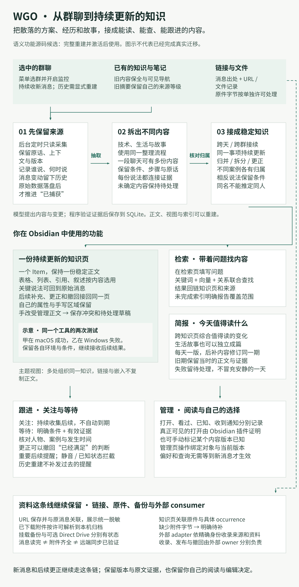

# WGO 语义整理与 Obsidian 阅读

这是新语义 generation 的使用说明。它描述本 checkout 的候选源码；安装、全量重建、激活和真实增量验收是独立步骤。没有 active generation 的已有安装继续使用原来的 topic/event monitor。完整操作见 [重建 runbook](semantic-rebuild.md)，当前交付状态见 [current state](current-state.md)。

WGO 把选中群聊里分散的方案、经历和故事接成可持续更新的知识页。你在菜单栏选群并开启监控，之后在 Obsidian 阅读完整内容、带着问题检索、看当天值得读的变化，并关注或等待某件事的后续。新选群从选择时刻起采集；全量历史需要显式重建。链接、已下载附件的归档与备份走独立的资源路径，各自报告完成或待补状态。



上图先回答「我能拿它做什么」。[实现走读](architecture/semantic-implementation.md)从消息到正文解释接线，完整技术 Mermaid 和源码表在同一文档末尾展开；[可编辑功能图和导出命令](architecture/README.md)用于维护。这些是源码支持的流程，完整迁移、激活和实际阅读验收仍须分别完成。

## 内容如何成为笔记

选中群聊的消息先保存为不可变的 SourceRecord 版本，再抽取零到多个 Observations。一个聊天窗口可以包含技术讨论、生活片段和玩笑；它们可以形成不同 Item，也可以为跨天、跨群的已有 Item 增补细节、证据或更正。阅读偏好不再决定哪些内容有资格留存，也没有旧版相关性分数门槛。不能确定的输入留在待处理状态，不能伪装成“无内容”。

SQLite 保存 canonical source、语义、关系、任务和提交证据。Markdown、全文和向量索引是可重建的阅读/检索结果。消息的发生时间、首次捕获时间和后来获知更正的时间分别保存；重新观察同一版本不会刷新内容，A→B→A 则保留三次变化。链接展示和模型输入仍使用统一 URL 脱敏规则；精确 URL 只留在私有 ledger。

整理保留成员归属：使用该条消息捕获时已有的名字，并用可验证的来源身份连接同一人的后续。同名、相邻发言或相似语气都不能证明同一人；缺少稳定身份时保持未知。发言人、转述者和被谈论的人物各有含义，不能把转发内容自动算作发言人的亲身经历，也不根据名字补写人物关系或动机。原始账户标识不作为展示名传给模型或写入阅读页。

新增消息的两条进度分别是 `captured_cursors` 与 `source_cursors`：前者在 raw rows 持久化后推进，后者必须等连续输入完成语义处理、canonical transaction 和 outbox 一起提交后才能推进。笔记冲突或远端向量尚未确认会保留待办，不会让成功的语义处理重跑模型。来源缺 shard 或 generation 改变仍失败关闭。

某段内容暂时无法判断时，菜单会说明“等待更多依据”；后续资料仍可先形成知识，完成进度停在未决缺口。已有事项或 View 上下文改变后会重新判断，普通空轮询不重复调用模型。旧资料与已接受的模型产物始终保留。

## 在 Obsidian 中阅读和操作

新 generation 使用固定的 `WGO/` 阅读根目录。Item 是持续更新的知识正文，保持稳定 `wgo_id`。`WGO/视图/` 下的 View 是主题目录页：通过链接或段落嵌入，把同一正文组织到不同主题下，不复制维护第二份正文，也不需要独立的查看器。简报保留当时的正文与证据。旧笔记有完整的冻结备份和可见的 Legacy 导航，不把旧摘要冒充原始聊天。

从菜单“打开阅读首页”进入 `WGO/首页.md`，可以继续阅读最近条目、新内容、更新、
关注与等待，或进入检索、管理、阅读状态、主题视图和今天最近成功的一版简报。
每类列表显示最近 20 条和总数，只给已就绪目标生成链接；未就绪时保留说明。
首页分别显示当前内容版本、实际可见打开版本和明确已知版本：打开过 v1 不会吞掉 v2，
没有可见打开插件也能明确确认已知。过长标签会显示简短说明，完整标题与等待条件仍在原条目；
含 Obsidian 保留分隔符的改名文件不生成伪有效链接，也不自动替用户改名。
首页使用同一套人工编辑保护与 identity 接续，不产生新的模型调用或修改阅读事实。

`WGO/主题管理.md` 让日常目录可以继续经营。Reader 每轮最多归纳 16 个 Item 的 scope，
完整目录上下文超过 60 KB 会明确等待处理；依赖没变或已知 defer 没变时不重复模型请求。
这是目录补充：新的归属不会自动移除旧成员，也不会合并 Item。
在目录页编辑「主题说明」后，回到主题管理勾选“采用你填写的主题说明”才会改变 canonical
定义；现有成员可固定、取消固定、排除或恢复显示。同一目录本次勾选的操作一起生效，
过期则一起拒绝，避免半套设置。每次默认列前 20 个目录及各自前 20 个成员；在管理页
「目录」属性填写目录双链、「条目」填写成员双链，可以选择默认列表之外的对象。
已有个人同名属性不会被接管；冲突目录有提示，其它目录继续可用。
管理页保留最近 10 项已应用或未应用的操作结果；被拒绝时，核对最新目录后再选择当前动作。

`WGO/变化.md` 和首页的“查看具体变化”比较明确已知版本与当前版本：新增内容、移出条目
的内容、claim 状态或条件更正、关系变化会分别说明。只有出处或目录整理变化时，不冒充
新增实质知识。没有已知确认时展示当前保留内容，不虚构 v0；打开记录不会改变基线。
预览有数量和长度上限，并提示未展示部分；需要完整内容时进入当前 Item，继续核对来源。
变化页复用人工冲突与重命名保护，不修改原始快照，也不新增模型调用。

新细节可以改写它所进入的自动段落，保持原段落位置、稳定链接与完整证据；不必先逐字重复旧句再追加说明。没有新内容的段落保持原样，准确原话与手写保护仍生效。

正文按内容选择 Markdown 形式：比较不同条件时可用表格，操作顺序用有序列表，平行要点用列表，准确原话用带归属和来源的引用。故事可以保留连续叙述，不强制插入表格。格式变化不能丢失条件、步骤或反证，也不能把不同成员各自的测试拼成一个人的完整成功案例。

每段正文下面的“本段原话”默认展开，直接嵌入对应来源块，可以在同一篇笔记里核对原话、
捕获的发言者；顶部只显示一行时间范围，下面是发言者和消息，点标题可收起。
来源页也采用这个简洁布局，不逐条重复来源时间、获知时间或机器归属标签。
单条消息和已经有行内引用的消息也保留这个入口。
它使用 Obsidian 原生块嵌入，正文与 `WGO/来源/` 必须位于同一个 Vault；单独在另一个 Vault
打开一份预览笔记不会同时带入配套来源。原话显示采用同一来源片段，URL 仍使用统一脱敏形式，
不新增模型请求，也不改变已接受的正文计划或 canonical 知识。

菜单中的“打开知识库目录”“打开检索”“打开阅读管理”进入这些页面：

- **检索.md**：在已注册的“查询”属性填写问题，源无关 reader worker 调用同一套 lexical、dense 与结构检索，返回可跳转的结果。远端 index 未确认时显示覆盖限制，不能把 TopK 没命中当成全库不存在。
- **管理.md**：勾选页面生成的操作。隐藏 action identity 绑定对象、内容版本和当前文件；手写一个相似 checkbox 不会得到执行权限。刷新会保留尚未消费的有效勾选，过期操作会明确报告。
- **Item properties**：默认使用“阅读关注”“阅读静音”“阅读等待”。字段首次注册时检查冲突，不接管已有同名用户数据。`semantic_reader_properties` 可以分别映射 `follow`、`mute`、`wait`、`query`；属性名必须唯一且不能使用保留的 `wgo_*` 前缀。

关注没有自动到期日。等待描述由模型提出可核对条件，typed decision 决定是否采用；缺少确切的 subject/case/time 证据会保持 `unknown`。等待支持一次发生与当前状态两种含义；旧测试不能证明“恢复后的完整实测”，有效替代证据尚在时也不会错误撤回已满足状态。同一份材料里只更正一项主张，不会连带撤回其它事实；明确转述这项结论的副本也会重新判断。
询问“当前是否仍成立”时，较新的相关反例与缺失限定会保留争议，不能靠旧成功报告确认现状。
Review 时间只是提醒重新审视。

“已知”只对应明确确认的内容版本。可选 [Obsidian visible-open bridge](../integrations/obsidian/README.md) 为实际可见页面生成本机事件；app 核对 generation、Item、内容版本、文件和路径后记录阅读。发出打开命令、mtime 变化或系统接受通知都不等于读过。没有插件时仍可显式标记已知。

WGO 只维护 `wgo_*` 属性和命名的 managed regions。用户自己的属性与正文区域保持原样。编辑了受管理正文时，WGO 保存 exact conflict backup 和待接受的 draft，在管理页提供解决动作；不会默默覆盖。文件重命名按稳定 identity 重新定位；identity 碰撞、symlink 或越出阅读根目录均拒绝。

## 简报与提醒

每日简报由一个 editor 综合跨 Item 的变化，生活故事可以独立成篇。没有固定的“技术/资源/风险”三栏。每个配置时区的日期只有一个 edition identity；到设定时间后，后续补充与更正修订同一期，不重复生成多个日期文件。旧期保留当时的冻结正文。编辑判断无值得读的变化是 `silent`；模型、证据或投影失败是 `deferred`，不能把失败当作安静的一天，上一版成功正文继续保留。

本地提醒在投递前重新核对最新静音/已知状态、canonical revision 和可打开的证据目标。事件、设备与 channel 共同防重；外部结果不明确时保持 unknown，不盲目重发。历史重建不会补发过去的提醒。通知点击使用 logical identity，文件重命名或 Item merge 后重新解析当前目标。

暂停监控停止新增来源采集；Obsidian 的轻量阅读控制仍独立运行。新选群聊从选择时间开始，保留同秒新行；再次调整列表不会重置已经迁移的群聊进度。旧 checkpoint 带 pending intent 时必须先由完整迁移证明其去向。

日常维护先处理阅读控制，再分别恢复正文与索引。Embedding/index 故障不会挡住独立正文，
单个页面的局部发布失败也不会取消其它可发布的知识；原模型任务、unknown 与手写冲突仍保留。
`阅读状态.md` 显示本轮索引、正文就绪数量、待发布、冲突与未处理情况。
这些是派生工作观察，不会倒退或擅自推进来源进度；完整重建仍须通过严格发布与独立验收。

## 模型与向量

Text、typed decision、embedding 与 vector index 各有显式角色：

| 角色 | 当前实现 | 数据边界 |
| --- | --- | --- |
| Text | 现有配置的 AI provider | 抽取、候选动作、正文和简报；无隐式换服务 |
| Decision | Cloudflare Clef 或显式 text decision route | 只返回受约束的 choice/score/noul |
| Embedding | 本机 loopback 服务或 Cloudflare BGE-M3 | 脱敏后的检索文本交给所选服务；本机 adapter 不跟随重定向或改换服务 |
| Vector index | 本地 cosine 或 Cloudflare Vectorize | SQLite 仍为 canonical；远端只放向量及允许的 opaque metadata |

本机 embedding 支持显式 OpenAI-compatible `/v1/embeddings` 或 Ollama native `/api/embed`；必须配置实际模型、维度和经部署确认的 context 容量，超限拒绝而不裁剪。Ollama native 另发送 `truncate:false`。服务自身须使用本地模型。完整本地路线还要求 Text 与 Decision 使用本地服务。选择本地 index 不会把 Cloudflare embedding 变成本地模型。Vectorize 按 WGO generation/profile 隔离，不能复用另一个应用的索引身份。远端写入只有在 mutation 和精确记录均确认后才能标记 indexed；HTTP 接受不是完成证据。

仅所选 Cloudflare 角色要求账户凭据与预算。本机 embedding＋本地索引＋text decision 不加载 Cloudflare 凭据或使用量数据库。Cloudflare 的账户 UTC 日预算在 app 级 usage ledger 预留，跨 generation 共用。外部使用量必须有未过期的确认；缺证据、额度耗尽或未知请求占用时阻断调用。普通 text provider 不套用 Cloudflare 免费额度。Semantic text 默认允许最多 16384 output tokens（普通摘要仍为 4096）；`semantic_text_output_tokens` 可按已配置模型能力调整。返回被截断是明确失败，不能进入 canonical 内容。

账户、Keychain 引用、source 路径、原始输入、向量及完整 SPEC 均留在私有运行目录。公共 WGO 提供通用 capture、resource ledger 与 snapshot transport；产品专用导入、selection、发布和撤回由公共 checkout 外的 adapter 拥有。公共 app 不启动或配置这些私有服务。

## 诊断与恢复

```bash
.venv/bin/python scripts/health_check.py --semantic-json
.venv/bin/python scripts/rebuild_knowledge.py --help
```

健康检查只报告本机已提交的 generation、capture/applied、jobs、index/projection 与预算证据；不读取微信、调用模型或替代迁移验收。`candidate`、`pending`、`unknown`、`blocked` 各有不同含义。故障恢复必须沿 [重建 runbook](semantic-rebuild.md) 的 exact run id，不能删除数据库、清空 checkpoint 或用一次新扫描覆盖原有 pending intent。

已激活 generation 的 `database.delivery` 另行报告本机通知结果计数。
`unknown` 或尚在 `sending` 的回执使总体保持未知；`deferred` 表示仍待交付。
明确拒收是可见的历史终态，单独不会永久阻断 generation，也不自动重发。
`accepted` 只证明通知被接受，`silent` 只说明静默处理，都不代表读过或已知。
旧库没有交付表时显示 `not_initialized`；未激活的 candidate 不探测交付状态，
普通 health 行显示 `not_probed`。健康检查不会初始化这些表或改变原回执。

预算状态按 generation 内完整 provider profile 的显式角色读取：Cloudflare Decision 或 Embedding 要求 Workers AI 证据，远端 Vectorize 只要求 Vectorize 证据。合法的本机 embedding＋本地 index＋text decision 显示 `provider_budget.state=not_required`、`ready=true`，不检查使用量数据库，也不代表本机模型服务已经在线。缺失或无效 profile 分别显示 `profile_missing`、`profile_invalid`，均不视为预算就绪；unknown job 仍保留为未知状态。

实现责任和机器契约分别见 [store](semantic-store-contract.md)、[engine](semantic-engine.md)、[provider](semantic-providers.md)、[reading](semantic-reading.md)、[legacy](semantic-legacy.md) 与 [monitor v3](monitor-state-v3.md)。
